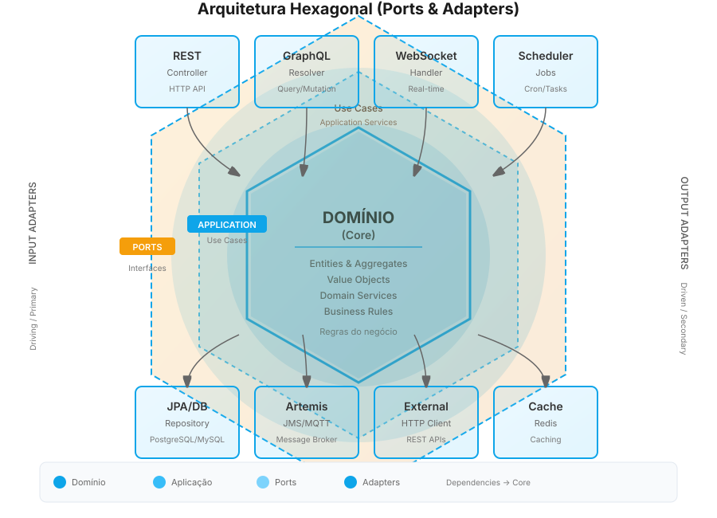

# Archbase Framework

[](https://central.sonatype.com/search?q=g:br.com.archbase)
[](https://openjdk.org/)
[](https://spring.io/projects/spring-boot)

**Archbase** é um framework Java para aplicações empresariais construído sobre Spring Boot 4.1 e Java 25. Implementa Domain-Driven Design (DDD) com Onion Architecture, oferecendo uma base sólida e modular para aplicações complexas.

> **Versão 3.5.0** - A versão mais recente publicada aparece no badge do Maven Central acima. Para atualizar: [2.x → 3.x](deployment/upgrade-2.x-para-3.x.md), [3.x → 3.5](deployment/upgrade-3.x-para-3.5.md) e [o que ligar em produção](deployment/security-hardening.md).

## Características

- **Domain-Driven Design** - Suporte completo a entidades, agregados, value objects e repositórios
- **Multi-tenancy** - Isolamento por coluna (`@TenantId`), tenant do token como fonte de verdade
- **Segurança** - JWT, autorização em cinco portões com `@HasPermission`, MFA, token de API, trilha de auditoria
- **IdP externo** (opt-in) - ArchGuard, Keycloak, Entra ID, Auth0, Okta via `archbase-security-oidc`
- **Event-Driven** - barramentos em memória para comandos, consultas e eventos
- **Query Flexível** - Suporte a RSQL para filtros dinâmicos
- **Validação** - Framework de validação com fluent interface
- **Workflow Engine** - Orquestração de processos de negócio
- **Plugin System** - Carregamento dinâmico de extensões

## Quick Start

### Adicione a dependência

```xml
<dependency>
    <groupId>br.com.archbase</groupId>
    <artifactId>archbase-starter</artifactId>
    <version>3.5.0</version>
</dependency>
```

Ou use módulos específicos:

```xml
<!-- Para apenas DDD básico -->
<dependency>
    <groupId>br.com.archbase</groupId>
    <artifactId>archbase-starter-core</artifactId>
    <version>3.5.0</version>
</dependency>

<!-- Para segurança -->
<dependency>
    <groupId>br.com.archbase</groupId>
    <artifactId>archbase-starter-security</artifactId>
    <version>3.5.0</version>
</dependency>

<!-- Para multi-tenancy -->
<dependency>
    <groupId>br.com.archbase</groupId>
    <artifactId>archbase-starter-multitenancy</artifactId>
    <version>3.5.0</version>
</dependency>
```

### Configure a aplicação

As propriedades marcadas como obrigatórias não têm valor padrão: sem elas a aplicação não sobe.

```yaml
archbase:
  security:
    scan-packages: com.suaempresa          # onde estão os @HasPermission
    jwt:
      secret-key: ${JWT_SECRET}            # obrigatória: Base64 de >= 32 bytes (openssl rand -base64 48)
      token-expiration: 3600000            # obrigatória, ms (1 hora)
      refresh-expiration: 604800000        # obrigatória, ms (7 dias)
    whitelist: /api/v1/public/**           # obrigatória: rotas públicas separadas por vírgula ("" = nenhuma)
    cors:                                  # obrigatórias
      allowed-origins: https://app.suaempresa.com
      allowed-methods: GET,POST,PUT,PATCH,DELETE,OPTIONS
      allowed-headers: "*"
      allow-credentials: true
  app:
    tenant:
      default:
        id: archbase
```

Os defaults de segurança preservam o comportamento de versões anteriores e deixam várias proteções
desligadas. Antes de ir para produção, leia [`deployment/security-hardening.md`](deployment/security-hardening.md).

### Crie uma entidade

Entidades JPA estendem `PersistenceEntityBase` ou, com multi-tenancy, `TenantPersistenceEntityBase`. As
classes base não são genéricas: o id é `String` (UUID gerado no construtor) e as colunas de auditoria
(`DH_CRIACAO`, `USUARIO_CRIOU`, `VERSAO`…) vêm herdadas.

```java
@Entity
@Table(name = "CLIENTE")
@Getter
@Setter
public class Cliente extends TenantPersistenceEntityBase {

    @Column(name = "NOME")
    private String nome;

    @Column(name = "EMAIL")
    private String email;
}
```

A validação fica num validador fluente:

```java
public class ClienteValidator extends AbstractArchbaseValidator<Cliente> {
    @Override
    public void rules() {
        ruleFor(Cliente::getNome)
            .must(not(stringEmptyOrNull()))
            .withMessage("Nome é obrigatório");
    }
}

// uso: new ClienteValidator().validate(cliente).isValid()
```

### Crie um repositório

```java
public interface ClienteRepository
    extends ArchbaseCommonJpaRepository<Cliente, String, Long> {
    // CRUD, QueryDSL, JpaSpecificationExecutor e revisões (Envers)
}
```

### Crie um controller

`@HasPermission` só vale em **método** e exige `description` (é o texto que o administrador vê ao
conceder). Para não repetir o recurso, declare `@ArchbaseResource` na classe.

```java
@RestController
@RequestMapping("/api/clientes")
@ArchbaseResource(value = "CLIENTE", description = "Clientes")
public class ClienteController {

    private final ClienteRepository repository;

    public ClienteController(ClienteRepository repository) {
        this.repository = repository;
    }

    @GetMapping
    @HasPermission(action = "VIEW", description = "Consultar clientes")
    public Page<Cliente> buscar(@RequestParam(required = false) String filter, Pageable pageable) {
        Specification<Cliente> spec = filter == null
            ? Specification.unrestricted()
            : ArchbaseRSQLJPASupport.toSpecification(filter);
        return repository.findAll(spec, pageable);
    }

    @PostMapping
    @HasPermission(action = "CREATE", description = "Cadastrar cliente")
    public Cliente criar(@RequestBody @Valid Cliente cliente) {
        return repository.save(cliente);
    }
}
```

Endpoints públicos entram em `archbase.security.whitelist`. `@PermitAll`, `@RolesAllowed` e `@Secured`
**não têm efeito**: só a segurança de método `prePost` está ligada.

## Módulos

São 40 módulos; a lista completa, com o propósito de cada um, está no [`CLAUDE.md`](CLAUDE.md#module-organization).
Os principais:

| Módulo | Descrição |
|--------|-----------|
| [`archbase-starter`](archbase-starter/README.md) | Agrega `starter-core`, `starter-security` e `starter-multitenancy` |
| [`archbase-starter-core`](archbase-starter-core/README.md) | Auto-configuração MVC, RSQL, validação e propagação de contexto em threads |
| [`archbase-starter-security`](archbase-starter-security/README.md) | Autenticação, autorização, esquema de segurança (`archbase.security.schema.mode`) |
| [`archbase-starter-multitenancy`](archbase-starter-multitenancy/README.md) | Interceptor e aspecto de tenant |
| [`archbase-domain-driven-design-spec`](archbase-domain-driven-design-spec/README.md) | Contratos DDD: `Repository`, `AggregateRoot`, bases de entidade, `ArchbaseTenantContext` |
| [`archbase-domain-driven-design`](archbase-domain-driven-design/README.md) | Implementação JPA dos repositórios |
| [`archbase-query`](archbase-query/README.md) | RSQL para JPA |
| [`archbase-security`](archbase-security/README.md) | `@HasPermission`, core de autorização, MFA, token de API, trilha de auditoria |
| [`archbase-security-oidc`](archbase-security-oidc/README.md) | IdP externo (opt-in): ArchGuard, Keycloak, Entra ID, Auth0, Okta |
| [`archbase-controlplane`](archbase-controlplane/README.md) | Integração com o Control Plane: licença, assentos, provisionamento (opt-in) |
| [`archbase-multitenancy`](archbase-multitenancy/README.md) | Isolamento de tenant e contexto |
| [`archbase-event-driven`](archbase-event-driven/README.md) | Barramentos em memória de comando, consulta e evento |
| [`archbase-workflow-process`](archbase-workflow-process/README.md) | Motor de workflow |
| [`archbase-plugin-manager`](archbase-plugin-manager/README.md) | Carregamento dinâmico de plugins |
| [`archbase-validation`](archbase-validation/README.md) | Validação fluente |
| [`archbase-error-handling`](archbase-error-handling/README.md) | Tratamento centralizado de erros |
| [`archbase-hypersistence`](archbase-hypersistence/README.md) | Hypersistence Utils (tipos JSON, array e range) e contagem de SQL em testes |
| [`archbase-analytics`](archbase-analytics/README.md) | Proxy auditado para a camada semântica Cube (opt-in) |

## Arquitetura

O framework segue **Hexagonal Architecture** (Ports & Adapters) com separação clara de responsabilidades:



## Recursos Avançados

### Multi-tenancy

```java
@Entity
@Table(name = "PRODUTO")
public class Produto extends TenantPersistenceEntityBase {
    // TENANT_ID é @TenantId: gravado e filtrado pelo Hibernate com o tenant do contexto
}
```

### Comandos e consultas

```java
@Configuration
@Import(MessageBusSpringConfiguration.class)
@HandlerScan(basePackages = "com.minhaempresa.handlers")
public class HandlerConfig {
}

// Não é @Component: o barramento cria uma instância por despacho, com injeção de dependências
@CommandMapping(CriarProdutoCommand.class)
public class CriarProdutoHandler implements CommandHandler<CriarProdutoCommand, String> {
    @Override
    public String handle(CriarProdutoCommand command) {
        // Lógica do comando
        return id;
    }
}
```

Os barramentos são em memória e síncronos. Detalhes e limitações no
[README do archbase-event-driven](archbase-event-driven/README.md).

### Autenticação Programática

```java
@Autowired
private SystemUserContext systemUserContext; // br.com.archbase.security.usecase

public void processarJob() {
    systemUserContext.runAsSystemUser("system@empresa.com", () -> {
        // Executa como usuário do sistema
    });
}
```

### Workflow Engine

```java
// validar, processarPagamento e enviarConfirmacao implementam Work
SequentialFlow pedido = SequentialFlow.Builder.aNewSequentialFlow()
    .named("pedido-workflow")
    .execute(validar)
    .then(processarPagamento)
    .then(enviarConfirmacao)
    .build();

WorkFlowEngine engine = WorkFlowEngineBuilder.aNewWorkFlowEngine().build();
WorkReport report = engine.run(pedido, new WorkContext());
```

## Documentação

Para documentação completa e detalhada, visite:

- [Guia do Usuário](https://archbase.dev/pt/)
- [API Reference](https://javadoc.io/doc/br.com.archbase/archbase-starter)

## Requisitos

- Java 25
- Spring Boot 4.1
- Maven 3.6+

## Licença

Copyright © 2024 Relevant Solutions

## Links Úteis

- [Site Oficial e documentação](https://archbase.dev/pt/)
- [Maven Central](https://central.sonatype.com/search?q=g:br.com.archbase)
- [GitHub](https://github.com/edsonmartins/archbase-app-framework)

## Versão 1.x

Para a versão 1.x do framework, use a branch [V1](https://github.com/edsonmartins/archbase-app-framework/tree/V1).
